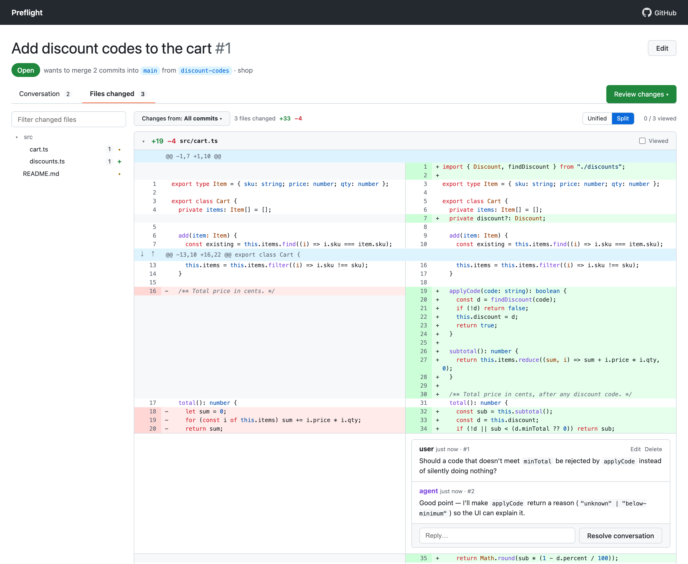

# preflight

Preflight PRs: review LLM agent work locally *before* it becomes a remote PR.
The agent opens a "preflight PR" between two local branches, you review it in a GitHub-like
web UI on localhost, and the agent reads your comments back via the CLI.



## Build

Requires Rust and Node.js. `cargo build` also builds the React app (`web/`) and embeds it in the binary.

```bash
cargo install --git https://github.com/zhxiaogg/preflight.git
```

## Use

Start the review server (keep it running):

```bash
preflight serve      # http://localhost:7777  (--port or PREFLIGHT_PORT to change)
```

Agent opens a preflight PR (diff is `base...head`, computed live, so new commits show up on reload):

```bash
preflight pr create --repo /path/to/repo --base main --head my-feature --title "Add X" --description "Why…"
```

Review in the browser like on GitHub:

- **Files changed**: syntax-highlighted diffs with a file tree, using the full window width; switch between
  **Unified** and **Split** (side-by-side). Expand hidden context around hunks (↑ up, ↓ down) and mark
  files **Viewed**.
- **Comments**: `+` on a line to comment on either side; drag the `+` or shift-click line numbers to comment
  on several lines. Reply, resolve, and edit or delete your own comments. Markdown everywhere.
- **Reviews**: **Start a review** on a line to batch comments. They stay pending (hidden from the agent)
  until you **Finish your review**, then go out together with an optional summary. **Add single comment**
  posts right away.
- **Commits**: click one to see just its changes, or check two (in the Conversation tab or the
  **Changes from** menu) to see everything between them; those views are read-only. A banner appears
  when the agent pushes new commits.
- **PR**: edit the title, description (markdown) and base branch; close and reopen. Closed PRs stay
  viewable at the commits they had, even after their branches are deleted.

Agent reads feedback and responds:

```bash
preflight pr wait 1                    # block until the reviewer submits a review (--timeout N: exit 2)
preflight pr wait 1 --any              # ...or until any reviewer activity, printing what changed
preflight pr events 1 --since 0        # everything that changed, incl. edited/deleted comments
preflight pr edit 1 --title "…" --base dev   # change title / base; --description - reads stdin
preflight pr edit 1 --repo ~/src/app       # repoint at another checkout (e.g. after its worktree was removed)
preflight pr close 1 2 3               # or reopen; closed PRs are hidden from `pr list` (use --all)
preflight pr list

preflight comment list 1 --unresolved          # latest review + threads, with file:line and the line's code
preflight comment list 1 --unresolved --json   # {state, latest_review, threads, event_cursor}
preflight comment create 1 "Ready for another look"                # on the conversation
preflight comment create 1 "Why this?" --file src/a.rs --line 42   # on a diff line (--side old: deleted line)
preflight comment create 1 "…" --file src/a.rs --start-line 40 --line 42   # a range; body "-" reads stdin
preflight comment reply 3 "Fixed in abc123"
preflight comment edit 7 "Updated: …"   # only the agent's own comments; body "-" reads stdin
preflight comment delete 7
preflight comment resolve 3
```

PRs created inside a git worktree are stored against the main repo, so they keep working after the worktree is removed.
State lives in SQLite at `~/.preflight/preflight.db` (override with `PREFLIGHT_DB`). The CLI works without the server running.

## Agent instructions snippet

Paste into your agent's `CLAUDE.md` / `AGENTS.md`:

```markdown
A "preflight PR" is a local review done with the `preflight` CLI, not a GitHub PR.
When asked to open a preflight PR for a branch:
`preflight pr create --repo . --base main --head <branch> --title "<title>" --description "<summary>"`
and share the printed URL. Then run `preflight pr wait <id>` to block until the reviewer submits a review;
it prints the review and the unresolved comments. Reviewers may edit or delete comments later, so
catch up with `preflight pr events <id> --since <cursor>` (the cursor is printed at the end, and
`comment list --json` includes it as `event_cursor`) before treating feedback as final.
For each thread: make the fix, commit it to the same branch, then `preflight comment reply <comment-id> "<what you did>"`.
To point the reviewer at something (a question, a trade-off, a risky spot), comment on the diff with
`preflight comment create <id> "<note>" --file <path> --line <n>`; only lines shown in the diff can be commented on.
Keep the description current with `preflight pr edit <id> --description -` (reads markdown from stdin).
Don't resolve threads yourself unless asked; the reviewer resolves them.
```

## HTTP API

| Method | Path | |
|---|---|---|
| GET/POST | `/api/prs` | list / create (`{repo, base, head, title, description}`) |
| GET/PATCH | `/api/prs/:id` | PR + base/head sha + commits / edit (`{title?, description?, base?}`) |
| GET | `/api/prs/:id/branches` | branches that can be picked as the base |
| GET | `/api/prs/:id/diff` | raw unified diff (`?from=<oid>&to=<oid>` for a range of the PR's commits) |
| GET | `/api/prs/:id/file` | file contents (`?path=…&rev=<oid>`), for expanding context |
| GET/POST | `/api/prs/:id/comments` | list / add (`{body, parent_id?, path?, line?, side?, start_line?, start_side?, line_text?, author?, pending?}`); `pending` holds it for the next review |
| GET/POST | `/api/prs/:id/reviews` | list / submit (`{state: commented, body}`), publishing your pending comments with it |
| POST | `/api/prs/:id/state` | `{state: open\|closed}` |
| PATCH/DELETE | `/api/comments/:id` | edit (`{body}`) / delete your own (`user`) comment |
| POST | `/api/comments/:id/resolve` | `{resolved: bool}` |

The server binds to `127.0.0.1` only.

## Not in the MVP

Merging, uncommitted working-tree diffs.
